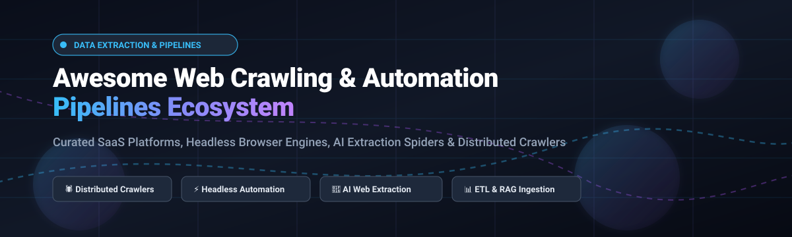

# 🕷️ Awesome Web Crawling & Automation Pipelines

  
  
  
  
  

**A curated, production-grade directory of enterprise SaaS platforms, open-source scraping frameworks, browser automation runtimes, AI web extraction agents, and high-throughput data ingestion pipelines.**

---

### 🌐 Overview & SEO Keywords
> **Target Concepts**: Web Crawling, Web Scraping, Browser Automation, LLM Web Agents, Headless Chrome, Playwright, Scrapy, Puppeteer, AI Structured Data Extraction, Proxy Management, SERP APIs, CAPTCHA Bypass, Distributed Spiders, ETL Data Ingestion, Retrieval-Augmented Generation (RAG).

---

## 📑 Table of Contents
- [📊 Sector Overview & Market Dynamics](#-sector-overview--market-dynamics)
- [☁️ SaaS / Hosted Platforms](#️-saas--hosted-platforms)
- [🛠️ Open-Source GitHub Projects](#️-open-source-github-projects)
- [🤝 How to Contribute](#-how-to-contribute)
- [💖 Support & Sponsorship](#-support--sponsorship)
- [📈 Star History](#-star-history)
- [📜 Disclaimer](#-disclaimer)

---

## 📊 Sector Overview & Market Dynamics

The global **web scraping, web crawling, and automated data extraction market** is valued between **$1.6 billion and $1.8 billion**, with forward-looking industry projections forecasting rapid expansion to **over $11 billion by the 2030s** (accelerating at a compound annual growth rate exceeding 14–17%). Within this landscape, specialized AI-driven web extraction and intelligent RAG data ingestion pipelines represent the fastest-growing sub-segment, fueled by large language models requiring continuous, high-volume, real-time structured data from across the public web.

From a structural perspective, the market displays **moderate fragmentation with an emergent bifurcated concentration**:
1. **Infrastructure & Proxy Layer (Concentrated / Oligopoly-leaning)**: Core enterprise residential proxy IP distribution and automated CAPTCHA unblocking infrastructure are dominated by a handful of well-capitalized multi-hundred-million-dollar leaders (notably Oxylabs and Bright Data, alongside Zyte and Decodo). High bandwidth agreements, global IP compliance, and anti-bot arms races create formidable technical and capital moats.
2. **Application, Agentic & Pipeline Layer (Highly Fragmented / Dynamic Innovation)**: The developer-facing ecosystem—encompassing headless browser orchestration, AI web agents, self-hosted crawler schedulers, and zero-code scrapers—is intensely competitive and diversified. Fast-moving startups and prolific open-source engines (e.g., Firecrawl, Crawl4AI, Browser-Use, Stagehand, Scrapy) prevent a single "winner-take-all" outcome, allowing developers to choose specialized, modular tooling tailored for ETL pipelines, e-commerce price tracking, LLM knowledge bases, or cybersecurity intelligence.

---

## ☁️ SaaS / Hosted Platforms

Below is an exhaustive comparison of the top hosted web crawling and data extraction platforms, sorted descending by company size (annual recurring revenue and enterprise valuation metrics).

| Company / Product | Scale (Revenue / Valuation) | Starting Paid Pricing | Free Forever / Trial Limit | Key Capabilities & Architecture |
| :--- | :--- | :--- | :--- | :--- |
| **[Oxylabs](https://oxylabs.io)** | **$3.6B Valuation** / ~$350M ARR | **$49 / month** (Micro Web Unblocker / Scraper API) or $4/GB PAYG | **7-day free trial** with dedicated test traffic allowance for business entities (corporate email required) | Enterprise web scraping infrastructure, AI Web Unblocker, 102M+ residential IPs, dedicated crawler APIs, and headless rendering. |
| **[Bright Data](https://brightdata.com)** | **~$300M+ ARR** (Global leader) | **$8.40 / GB** (Residential PAYG) or ~$3 per 1,000 successful requests | **Free forever plan: 5,000 requests/month** across Web Scraper, SERP, and Web Unlocker APIs (no credit card required) | Full-stack web data platform combining Scraping Browser automation, Web Unlocker, SERP APIs, residential proxies, and pre-built datasets. |
| **[Zyte](https://zyte.com)** *(Scrapinghub)* | **~$25M ARR** (Series A / Bootstrapped) | **$9 / month per unit** (Scrapy Cloud) or usage-based Zyte API | **Free forever plan: 1 concurrent Scrapy Cloud worker** (1-hour job runtime max, 7-day data retention) + $5 free Zyte API credit | Creators of Scrapy; enterprise extraction cloud providing Scrapy Cloud hosting, Zyte API unblocking, and AI automated spider pipelines. |
| **[Diffbot](https://diffbot.com)** | **~$50M–$100M Valuation** / ~$4M ARR | **$299 / month** (Startup tier, 250k credits) | **Free forever plan: 10,000 credits/month** (extract API, 5 req/min, plus 500 NL API calls & 400 Knowledge Graph entities) | Computer vision & NLP web crawler converting unstructured domain pages into structured entities and global Knowledge Graph records. |
| **[Apify](https://apify.com)** | **~$13M–$15M ARR** / Fast-growing | **$19 / month** (Starter plan with $19 platform usage credits) | **Free forever plan: $5 in monthly platform credits** (up to 16 GB concurrent RAM, 5 concurrent runs, and 5 datacenter proxies) | Serverless cloud web scraping and browser automation platform featuring 2,000+ composable Actors, cron schedules, webhooks, and dataset storage. |
| **[Firecrawl Cloud](https://firecrawl.dev)** | **$90M+ Raised** (Series B funded) | **$19 / month** (Hobby plan, 5,000 credits/month) | **Free forever plan: 1,000 credits/month** (covers up to 1,000 page scrapes/crawls or structured JSON extractions) | Developer-centric web crawler converting entire websites into clean Markdown and structured JSON for LLM RAG applications. |
| **[Decodo](https://decodo.com)** *(Smartproxy)* | **~$10M+ Est. ARR** (Bootstrapped) | **$11.25 / month** (Residential 3 GB) or $19 / month (Web Scraping API) | **3-day free trial** with 100 MB proxy data (card required upfront) or **$5 free credit** (up to 10k requests) on Scraping API | Residential/ISP proxy networks, automated Scraping API, SERP scrapers, and scheduled cloud headless browser sessions. |
| **[ScraperAPI](https://scraperapi.com)** | **~$4M+ ARR** (Acquired by SaaS.group) | **$49 / month** (Hobby plan, 100,000 API credits, 20 threads) | **Free forever plan: 1,000 API credits/month** (5 concurrent threads, no credit card required) | Managed scraping API automating residential IP rotation, JS rendering, CAPTCHA mitigation, and asynchronous callback pipelines. |
| **[ScrapingBee](https://scrapingbee.com)** | **~$5M ARR** (Acquired by Oxylabs) | **$19 / month** (Hobby plan, 75,000 credits, 25 concurrency) | **Free trial: 1,000 credits total** (one-time test allowance, no credit card required) | Cloud headless Chrome API handling JavaScript evaluation, rotating residential proxies, automated screenshots, and AI web extraction. |
| **[Crawlbase](https://crawlbase.com)** | **~$3M+ Est. ARR** (Bootstrapped) | **$99 / month** (Subscription tier) or Pay-As-You-Go from $0.002/req | **Free trial: 5,000 free requests** (1,000 on signup, additional unlocked through guided onboarding, no credit card required) | Asynchronous Crawler APIs, Smart AI Proxies, headless JavaScript rendering, and cloud storage pipelines for continuous extraction. |
| **[WebScraping.AI](https://webscraping.ai)** | **~$1M+ Est. ARR** (Indie SaaS) | **$29 / month** (Small tier, 250,000 credits) | **Free forever plan: 2,000 API credits/month** (2 concurrent requests, no credit card required) | Scraping API combining Chromium rendering, proxy rotation, and built-in LLM structured data parsing for quick pipeline integration. |

---

## 🛠️ Open-Source GitHub Projects

The following curated open-source projects power modern web data extraction, browser automation, and crawling pipelines. Repositories are ranked in descending order by GitHub star count.

| Project & Repository | Star Count | Architecture & Tech Stack | Description |
| :--- | :--- | :--- | :--- |
| **[n8n](https://github.com/n8n-io/n8n)** |  | TypeScript / Node.js | Fair-code/open-source workflow automation platform widely used to orchestrate scheduled HTTP/Playwright/Firecrawl scraping pipelines, AI parsing, and database ingestion. |
| **[Firecrawl OSS](https://github.com/mendableai/firecrawl)** |  | TypeScript / Python / Redis | Self-hostable open-source crawling and scraping engine converting entire websites into structured data and LLM-ready clean Markdown using Playwright workers and Redis queues. |
| **[Browser-Use](https://github.com/browser-use/browser-use)** |  | Python / Playwright | Popular open-source Python framework enabling LLM agents to autonomously navigate websites, fill forms, paginate, and extract structured pipeline outputs via Playwright. |
| **[Playwright](https://github.com/microsoft/playwright)** |  | TypeScript / C# / Python / Java | Cross-browser open-source automation framework for Chromium, Firefox, and WebKit providing auto-waiting, network interception, and parallel worker contexts for scraping pipelines. |
| **[Puppeteer](https://github.com/puppeteer/puppeteer)** |  | JavaScript / Node.js | The foundational Node.js library providing a high-level API to control headless Chrome or Chromium over the Chrome DevTools Protocol (CDP). |
| **[Crawl4AI](https://github.com/unclecode/crawl4ai)** |  | Python / AsyncIO | High-speed open-source LLM-friendly web crawler and extraction pipeline producing clean Markdown, structured JSON schemas, and deep recursive site crawls for RAG systems. |
| **[Scrapy](https://github.com/scrapy/scrapy)** |  | Python / Twisted | The industry-standard open-source Python web crawling and scraping framework built for high-throughput asynchronous spiders, item pipelines, and custom middlewares. |
| **[Changedetection.io](https://github.com/dgtlmoon/changedetection.io)** |  | Python / Playwright | Self-hosted open-source website change monitoring and Playwright scraping pipeline with XPath/CSS/JSONPath filters and webhook triggers. |
| **[Selenium](https://github.com/SeleniumHQ/selenium)** |  | Multi-Language (Java, Python, JS, C#) | Proven browser automation framework enabling distributed browser grid execution across major desktop and mobile web engines. |
| **[ScrapeGraphAI](https://github.com/ScrapeGraphAI/Scrapegraph-ai)** |  | Python / LangChain | Open-source Python scraping library using LLMs and directed graph pipelines to extract structured datasets from websites, sitemaps, and local documents. |
| **[GPT-Researcher](https://github.com/assafelovic/gpt-researcher)** |  | Python | Autonomous agent designed for comprehensive online research that crawls 20+ web sources per query and aggregates verified summary reports. |
| **[ArchiveBox](https://github.com/ArchiveBox/ArchiveBox)** |  | Python / Django | Open-source self-hosted internet archiving pipeline that captures websites as HTML, PDF, WARC, screenshot, and readable text via headless browser workers. |
| **[Crawlee](https://github.com/apify/crawlee)** |  | TypeScript / Python | Full-featured open-source web scraping and browser automation framework for Node.js and Python (`crawlee-python`) supporting Playwright, Puppeteer, and Cheerio with persistent request queues and autoscaling. |
| **[Stagehand](https://github.com/browserbase/stagehand)** |  | TypeScript / Playwright | Open-source AI browser automation SDK built on Playwright combining natural-language `act`, `extract`, and `observe` actions with deterministic TypeScript/Python pipelines. |
| **[Colly](https://github.com/gocolly/colly)** |  | Go | Lightning-fast open-source Go web scraping and crawling framework capable of parallel domain-scoped crawls, distributed storage backends, and over 1,000 requests per second. |
| **[Skyvern](https://github.com/Skyvern-AI/skyvern)** |  | Python / Playwright | Open-source workflow automation and web scraping engine combining vision LLMs and Playwright to automate complex browser pipelines across unseen websites. |
| **[Maxun](https://github.com/getmaxun/maxun)** |  | TypeScript / Playwright | Open-source no-code web data extraction platform that records user actions to build automated scraping robots, scheduled workflows, and REST APIs. |
| **[Katana](https://github.com/projectdiscovery/katana)** |  | Go | Next-generation open-source crawling and spidering engine written in Go supporting both standard HTTP and headless Chrome crawling, scope filtering, and JSONL pipeline output. |
| **[pyspider](https://github.com/binux/pyspider)** |  | Python | Powerful web crawler system in Python with a web-based UI script editor, task scheduler, result viewer, and distributed database backends. |
| **[chromedp](https://github.com/chromedp/chromedp)** |  | Go | Fast, idiomatic open-source Go library for driving Chrome/Chromium browsers over CDP without external WebDriver binaries. |
| **[undetected-chromedriver](https://github.com/ultrafunkamsterdam/undetected-chromedriver)** |  | Python | Custom Selenium Chromedriver patch that bypasses Cloudflare, Akamai, and perimeter anti-bot detection systems during automated runs. |
| **[Crawlab](https://github.com/crawlab-team/crawlab)** |  | Go / Vue.js | Distributed open-source web crawler admin platform written in Go supporting Python, Node.js, Go, Java, and Scrapy spiders with task scheduling and data export. |
| **[puppeteer-extra](https://github.com/berstend/puppeteer-extra)** |  | TypeScript / JavaScript | Modular plugin ecosystem for Puppeteer including the acclaimed stealth plugin to prevent bot fingerprinting during crawls. |
| **[Rod](https://github.com/go-rod/rod)** |  | Go | High-level open-source Go DevTools Protocol driver engineered for reliable headless Chrome/Chromium automation, web crawling, and concurrent scraping pipelines. |
| **[Ferret](https://github.com/MontFerret/ferret)** |  | Go | Declarative open-source web scraping system written in Go featuring a SQL-like query language (FQL) to automate complex multi-step browser interactions and data extraction. |
| **[Splash](https://github.com/scrapinghub/splash)** |  | Python / Twisted / Qt | Lightweight, scriptable headless browser with an HTTP API designed specifically for Scrapy integration, rendering JavaScript and executing custom Lua scripts. |
| **[GoClaw](https://github.com/nextlevelbuilder/goclaw)** |  | Go / PostgreSQL | Open-source multi-agent AI gateway and automation pipeline runtime written in Go featuring multi-tenant PostgreSQL isolation, MCP tool integration, scheduled jobs, and web browsing/crawling workflows. |
| **[Gerapy](https://github.com/Gerapy/Gerapy)** |  | Python / Django / Vue | Open-source distributed Scrapy management framework built with Django and Vue.js for visual spider scheduling, host monitoring, and code deployment. |
| **[ScrapydWeb](https://github.com/my8100/scrapydweb)** |  | Python / Flask | Open-source web application for multi-node Scrapyd cluster management, visual log analysis, timer tasks, and mobile/email crawl alerts. |
| **[Heritrix3](https://github.com/internetarchive/heritrix3)** |  | Java | The Internet Archive's open-source, extensible, web-scale archival crawler engineered for polite, high-volume WARC web capture. |
| **[Apache Nutch](https://github.com/apache/nutch)** |  | Java / Hadoop | Extensible, highly scalable open-source Java web crawler designed for massive distributed web-scale crawling with Apache Hadoop, Spark, and Elasticsearch/OpenSearch. |
| **[scrapy-splash](https://github.com/scrapy-plugins/scrapy-splash)** |  | Python | Scrapy middleware providing smooth integration with Splash headless browsers to render JavaScript on demanded URLs transparently. |
| **[Scrapyd](https://github.com/scrapy/scrapyd)** |  | Python / Twisted | Official open-source service daemon for deploying, scheduling, and running Scrapy spiders via JSON HTTP APIs—serving as a self-hosted core alternative to Scrapy Cloud. |
| **[Grab](https://github.com/lorien/grab)** |  | Python / PyCurl | High-performance Python web scraping and crawling framework built on pycurl with asynchronous multi-threaded spider task queues. |
| **[StormCrawler](https://github.com/apache/stormcrawler)** |  | Java / Apache Storm | Open-source collection of reusable resources for building low-latency, scalable web crawlers on Apache Storm for continuous streaming data pipelines. |

---

## 🤝 How to Contribute

Contributions are always welcome! Help us keep this directory accurate and forward-looking.

1. **Fork the Repository** on GitHub.
2. **Create a Feature Branch** (`git checkout -b feature/add-new-tool`).
3. **Add your Tool**: Ensure it fits web crawling, browser automation, or data extraction pipeline domains. Keep descriptions objective and factual.
4. **Commit your Changes** (`git commit -m "Add new crawler project"`).
5. **Push to the Branch** (`git push origin feature/add-new-tool`).
6. **Open a Pull Request** explaining why the tool or resource is valuable to the community.

---

## 💖 Support & Sponsorship

Thank you for exploring and utilizing this ecosystem directory! If you found this repository helpful for your projects, data engineering pipelines, or research:

- ⭐ **Star this repository** to support discovery and visibility!
- 🍴 **Fork it** to bookmark or customize your personal pipeline stacks.
- 📢 **Share it** with friends, colleagues, and data engineering communities.
- ☕ **Buy me a coffee**: Support ongoing maintenance and open-source contributions via the [GitHub Sponsor Dashboard](https://github.com/sponsors/ishandutta2007).

Your encouragement and support help keep this list updated with the latest tools!

---

## 📈 Star History

---

## 📜 Disclaimer

This repository is maintained for informational and educational purposes only. All company names, trademarks, product names, logos, and brands mentioned are the property of their respective owners. Users must adhere to website terms of service, robots.txt directives, and local data privacy regulations (e.g., GDPR, CCPA) when configuring and running web crawlers.
